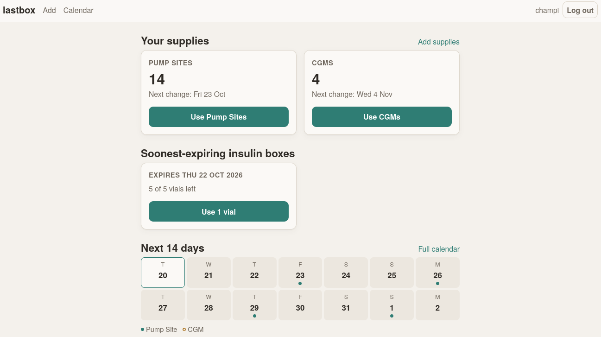
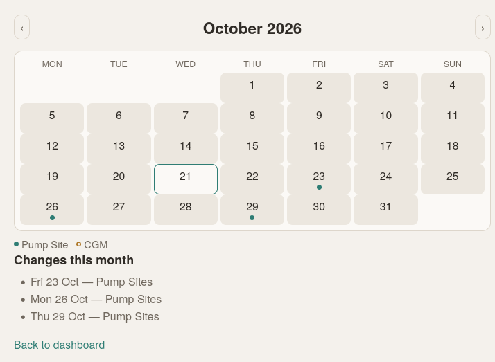
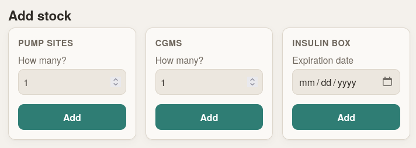

## Why was LastBox created

People on continuous insulin therapy have different supplies they have to keep track of, so the objective for this project is to make this as easy as possible.

Type 1 diabetics specifically go through supplies on somewhat predictable schedules. This app offers an easy way to have a general overview of how much supplies a user has at any moment and how long would they last. It dosen't provide medical advice, just helps with inventory management.

## Key Features

### Dashboard

General overview that allows to quickly mark supplies as used, along a 14-day strip view gives an at-a-glance summary of upcoming supply changes.



### Calendar View

The calendar visualizes supply changes across months. Markers appear on dates when supplies are expected to change, helping users plan ahead.



### Separate add page

To avoid cluttering the main dashboard, the way to add new supplies was taken to a different interface, accessed through the top bar, or the link next to the supplies cards.




## The Stack

The main objective for this project was for me to review my Django knowledge, and i went with the setup i used, which is the most comfortable for me.

- **Django 5.2** with Python 3.11
- **SQLite** (single-file database — no external services)
- **Gunicorn** with WhiteNoise for static file serving
- **Docker Compose** for containerization
- **NixOS module** for declarative deployment (optional but nice)

All the design decisions circled the idea that this is a small personal / local tool, so i wanted to keep unneccesary dependencies to a minimum. 

The entire app runs on a home server, accessible over LAN or VPN. No cloud, no accounts on third-party servers. User has full control on how to serve the app outside of their home network.

## Deployment: Clone and Run

One of lastbox's design goals is a zero-friction deployment. Clone the repo and run a single script:

```bash
git clone <repo> lastbox
cd lastbox
./deploy.sh
```

That's it. The deploy script generates a secret key, creates directories, builds the Docker image, and starts the stack on port 8010. Data persists in `data/db.sqlite3`.

The detailed deployment instructions are in the [repository](https://github.com/champiw/lastbox).

#### NixOS support

My home server uses NixOS, so i added a declarative Nix module.

Add it to your configuration, point it at the repository directory, and systemd manages the Docker Compose lifecycle:

```nix
services.lastbox = {
  enable = true;
  directory = "/srv/lastbox";
  port = 8010;
  openFirewall = true;
};
```

The module uses a oneshot systemd unit with `--build` on restart, so `nixos-rebuild` after a `git pull` picks up changes automatically.

### Looking Ahead

LastBox is built for a specific use case — tracking diabetes supplies with minimal overhead. If you're on insulin and tired of juggling multiple apps or spreadsheets, it might be worth a look.

The codebase is small, the stack is simple, and the deployment is easy. That's the goal.

As of today, its an early version with just the barebones tools needed to keep a basic inventory. Overtime i will continue to add new features that i think will be useful for any users.

*LastBox is a personal project. If you find it useful or have ideas, check out the [repository](https://github.com/champiw/lastbox).*